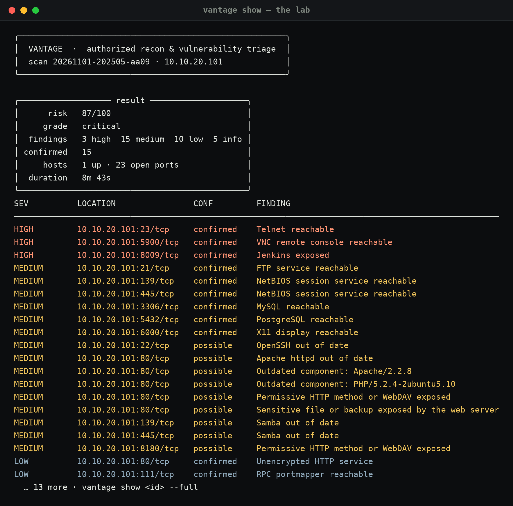
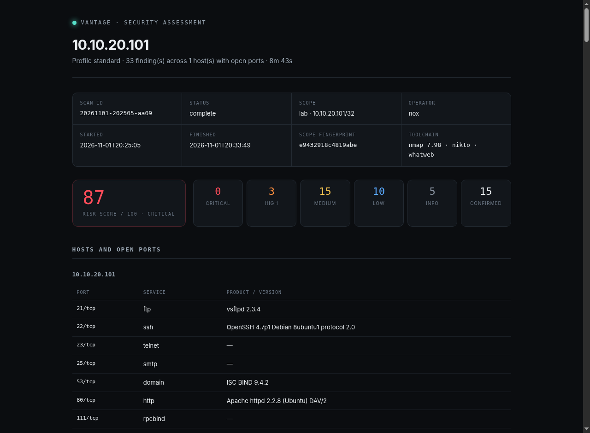
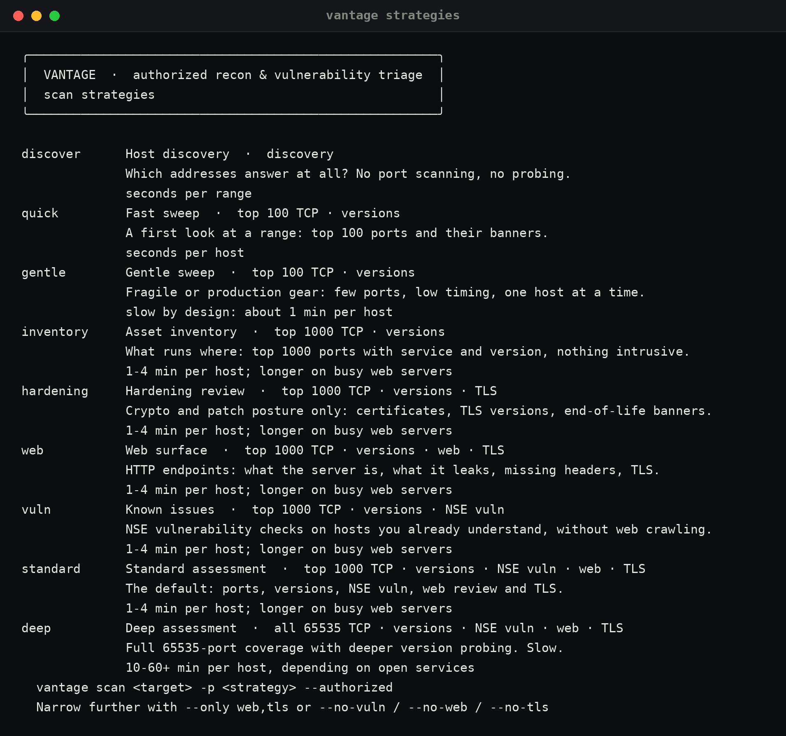

# Vantage

**Authorized network reconnaissance and vulnerability triage — from a terminal or a browser.**

I built this because I kept scanning my own lab with nmap and then doing the triage in
my head. Vantage wraps the scan in a scope you have to state up front, and does the
triage: what is exposed, what the evidence actually proves, and what to do about it.
The report keeps **confirmed** apart from **possible**, because that distinction is the
whole job.



```
$ vantage scan 192.168.1.0/24 --scope homelab.json --authorized

▸ 1/6 Host discovery
  ✓ 14 host(s) up
▸ 2/6 Port scan
  ✓ 37 open port(s) on 9 host(s)
▸ 3/6 Service & version detection
  ✓ banners collected
▸ 4/6 Vulnerability scripts (NSE)
  ✓ NSE checks complete
▸ 5/6 Web surface review
  ✓ 3 endpoint(s)
▸ 6/6 TLS inspection
  ✓ 2 endpoint(s)

╭──────────── result ─────────────╮
│      risk   64/100              │
│     grade   high                │
│  findings   1 critical · 3 high │
│ confirmed   4                   │
│     hosts   9 up · 37 open ports│
╰─────────────────────────────────╯
```

---

## What it does

| Phase | Tool | What you get |
|---|---|---|
| Host discovery | `nmap -sn` | Which addresses answer at all |
| Port scan | `nmap -sT` / `-sS` | Open TCP ports, with state and reason |
| Service detection | `nmap -sV` | Product, version and banner per port |
| Vulnerability scripts | `nmap --script vuln` | NSE results, graded by the answer they gave |
| Web surface | `whatweb`, `nikto` | Stack fingerprint, missing headers, exposed files |
| TLS inspection | `openssl` | Cert validity, trust, hostname match, TLS 1.0/1.1 acceptance |
| Analysis | built in | Findings with severity, **confidence**, evidence, and a fix |

Then it writes three artefacts per scan: a self-contained **HTML** report, a
**Markdown** one for notes, and **JSON** for tooling. Everything is stored in a
local SQLite database, so you can query history across scans.

## What it deliberately will not do

- Run without an explicit authorisation statement.
- Leave a declared scope — an out-of-scope target is refused *before a packet is sent*.
- Scan public addresses unless you pass `--allow-public` and mean it.
- Use credentials, attempt logins, or run exploitation frameworks.
- Pass `--script-args unsafe=1` to nmap (several NSE scripts can wedge fragile services).
- Call a version banner "vulnerable". Those come back as `possible` confidence with
  the reasoning attached.

## Install

Nothing to install if you already have the tools. Vantage is stdlib Python plus
`rich` and `flask`; it shells out to nmap/nikto/whatweb/openssl.

```bash
# required
sudo apt install nmap openssl
# optional, enable the web + TLS phases fully
sudo apt install nikto whatweb
# Python side
pip install rich jinja2 flask
```

Run it straight from the checkout:

```bash
git clone <this repo> vantage && cd vantage
./vantage doctor
./vantage scan 127.0.0.1 --authorized
```

Or install it:

```bash
pip install -e .
vantage --version
```

## Usage

### CLI

```bash
vantage scan 10.0.0.5 --authorized                        # single host, standard depth
vantage scan 192.168.1.0/24 -p quick --authorized         # fast sweep
vantage scan 192.168.1.0/24 -p discover --authorized      # who is alive
vantage scan 10.0.0.0/24 --scope client.json --authorized  # scope-enforced
vantage scan 10.0.0.5 -p deep --open-report                # all 65535 ports
vantage strategies                                         # what each strategy is for
vantage diff <older-id> <newer-id>                         # what changed
vantage ui                                                 # browser console on :8765
vantage history
vantage show <scan-id> --full
vantage findings --severity high
vantage report <scan-id> --format md
vantage audit --tail 30
vantage cat                                                # the cat
```

## Strategies

A strategy answers "what am I here to find out?", not just "how deep". Each one
runs a specific subset of phases, so a quick inventory never fires NSE scripts and
a crypto review never crawls your web app.

| Strategy | Phases | Use when |
|---|---|---|
| `discover` | host discovery | "which addresses are alive?" — no port scanning at all |
| `quick` | top 100 ports, versions | a first look, seconds per host |
| `gentle` | top 100 ports, versions, `-T2` | fragile gear: switches, IPMI, old printers |
| `inventory` | top 1000 ports, versions | asset inventory, nothing intrusive |
| `hardening` | + TLS | certificates, TLS versions, EOL banners only |
| `web` | + web review + TLS | is my HTTP surface exposing itself? |
| `vuln` | + NSE vuln | known-issue checks without web crawling |
| `standard` | everything | the default assessment |
| `deep` | all 65535 ports | full coverage, ten to sixty minutes per host |

```
vantage strategies                          # the list, with when-to-use
vantage scan 10.10.10.0/24 -p discover --authorized
vantage scan 10.10.10.5 -p hardening --authorized
vantage scan 10.10.10.5 -p inventory --only web,tls --authorized   # add phases
vantage scan 10.10.10.5 -p web --no-tls --authorized               # drop phases
```

See [docs/STRATEGIES.md](docs/STRATEGIES.md) for the reasoning behind each one.

## Live view

The CLI redraws a dashboard in place while the scan runs — phase timeline with
per-phase durations, hosts and open ports counted as nmap finds them, findings
streaming in, and the last tool message:

```
VANTAGE  ·  10.10.10.0/24  ·  standard   1m 12s
━━━━━━━━━━━━━━━━━━━━━━━━━━━━━━━━━━━━━━━━━━━━━━━━━━━━━ 42%  3/7
✓    Host discovery                                       9 host(s) up  3.2s
✓    Port scan                              37 port(s) on 9 host(s)  28.4s
▸    Service & version detection                                    running…
·    Vulnerability scripts (NSE)
·    Web surface review
·    TLS inspection
·    Analysis
9 host(s)  ·  37 open port(s)  ·  1H 3M 6L
 HIGH 10.10.10.5:445/tcp   SMBv1 EternalBlue (MS17-010) reported vulnerable
```

It falls back to line-by-line output when the output is not a terminal, when
`--plain` is passed, or when `--json` is in use. The web console shows the same
telemetry live: counters, phase timeline, and an asset stream.

## Comparing scans

```
vantage diff <base-scan-id> <compare-scan-id>          # what changed
vantage diff <base> <compare> --fail-on high            # exit 4 on new high+
vantage diff <base> <compare> --markdown changes.md
```

Reports new, resolved and still-present findings, severity/confidence changes,
and ports that opened or closed. Findings carry a stable key, so identity survives
a re-run. This is the monitoring workflow: scan nightly on a cron job, diff against
yesterday, alert on regressions.

Useful flags: `--ports 22,80,443`, `--timing 2` (gentle), `--no-vuln`,
`--no-web`, `--no-tls`, `--json`, `--fail-on high` (exit 4 for CI),
`--dry-run`, `--output DIR`.

### Web interface

```bash
vantage ui --port 8765
```

Bound to `127.0.0.1` only. It is an operator console, not a service — there is no
authentication because there is no remote access. Same engine, same scope checks,
same reports; scans run in a background thread and the page polls for progress.

Screens: new scan form with a mandatory authorisation checkbox → live progress with
a streaming console → results → the full report.

### Scope files

Anything you can declare up front, you can enforce. Vantage accepts JSON, TOML or
plain text:

```json
{
  "name": "homelab-q1",
  "client": "internal",
  "networks": ["192.168.1.0/24", "10.0.10.0/25"],
  "notes": "Written approval 2026-01-04, signed by the network owner"
}
```

```bash
vantage scope new --name homelab --targets 192.168.1.0/24 -o homelab.json
vantage scope check homelab.json
vantage scan 192.168.1.14 --scope homelab.json --authorized
```

A target outside the declared networks is refused with exit code 2, and the
attempt is written to the audit log.

## Reading the output

Two axes, kept apart on purpose:

- **Severity** — how bad it would be if the finding is real.
- **Confidence** — how sure *this scan* is that it is real.

```
confirmed    a check returned a positive answer (NSE said VULNERABLE,
             a TLS 1.0 handshake completed, the port is open)
likely       a strong signal, one manual step from confirmed
possible     a heuristic hit — nikto output, an end-of-life banner
informational  context, not a weakness
```

A report full of `possible` medium findings is a list of leads. A single
`confirmed` critical is an incident. Treating those the same is how pentest
reports lose their readers.

See [docs/FINDINGS.md](docs/FINDINGS.md) for the full model and the exact rules the
analyzer applies.

## Exit codes

| Code | Meaning |
|---|---|
| 0 | scan completed |
| 1 | error during the run |
| 2 | refused — authorisation or scope |
| 3 | required tool missing |
| 4 | `--fail-on` threshold met (CI gate) |

## Where things live

```
~/.local/share/vantage/
├── vantage.db                    scan history + findings (SQLite)
├── reports/<scan-id>/
│   ├── report.html               self-contained, printable
│   ├── report.md
│   └── report.json
└── logs/audit.jsonl              every authorisation decision, including refusals
```

Override with `VANTAGE_DATA_DIR=/some/path`.

## On a real target

The practice lab has a Metasploitable 2 box on an isolated subnet. A `standard`
scan of it — authorised, scoped to that single address, eight minutes — produced 33
findings:

| Severity | Count | Examples |
|---|---|---|
| **high** | 3 | Telnet reachable · VNC console reachable · Jenkins on 8009 |
| **medium** | 15 | FTP, MySQL, PostgreSQL, X11, NetBIOS exposed · Apache 2.2.8 · PHP 5.2.4 · Samba 3.x |
| **low** | 10 | unencrypted HTTP · RPC portmapper |
| info | 5 | service banners |

15 of the 33 are `confirmed` (a port answered, or a service named itself); the
version-based ones are `possible`, because a banner is the remote service's own claim
and backported fixes make banners lie.

Risk **87/100, grade critical** — which is the correct read for a box that is
supposed to be that broken.



Everything above is a port that answered and a service that identified itself. The
confidence column keeps the guesses separate — see [docs/FINDINGS.md](docs/FINDINGS.md).



## Legal

Vantage is built for **authorized** testing: your own lab, your employer's network
with written approval, or a client engagement with a signed scope. Port scanning
systems you do not own or have permission to test is a criminal offence in
Germany (§202a–c StGB), the US (CFAA), the UK (Computer Misuse Act) and most other
jurisdictions.

The tool enforces what it can — an explicit statement, scope membership, public
address gating, an audit trail — but authorisation is a legal fact, not a
checkbox. Read [docs/LEGAL.md](docs/LEGAL.md) before pointing it at anything.

## Documentation

- [docs/ARCHITECTURE.md](docs/ARCHITECTURE.md) — how the pieces fit, and why
- [docs/STRATEGIES.md](docs/STRATEGIES.md) — what each strategy is for, and composition
- [docs/USAGE.md](docs/USAGE.md) — every command, flag and workflow
- [docs/FINDINGS.md](docs/FINDINGS.md) — severity, confidence, and the rules
- [docs/LEGAL.md](docs/LEGAL.md) — authorisation, scope, and the audit trail
- [docs/DEVELOPMENT.md](docs/DEVELOPMENT.md) — layout, tests, extending it

## Tests

```bash
python3 -m unittest discover -s tests -t .
```

132 tests, stdlib only, no network required. They cover the authorisation gate,
scope parsing, nmap XML handling, the finding rules, report rendering and storage.

## Licence

MIT. See [LICENSE](LICENSE).
